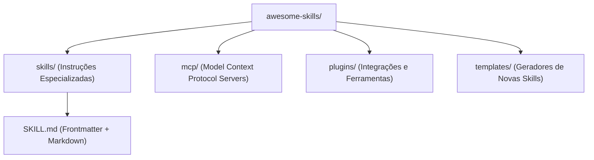

# DESIGN — Awesome Skills Architecture & Design Rules

## 1. Arquitetura do Catálogo

---

## 2. Padrões de Especificação de Skills

1. **Frontmatter Obrigatório:**
   - Todo arquivo `SKILL.md` deve conter `name` e `description`.
2. **Atomicidade:**
   - Cada skill deve ter escopo delimitado, evitando sobreposição de responsabilidades entre agentes.
