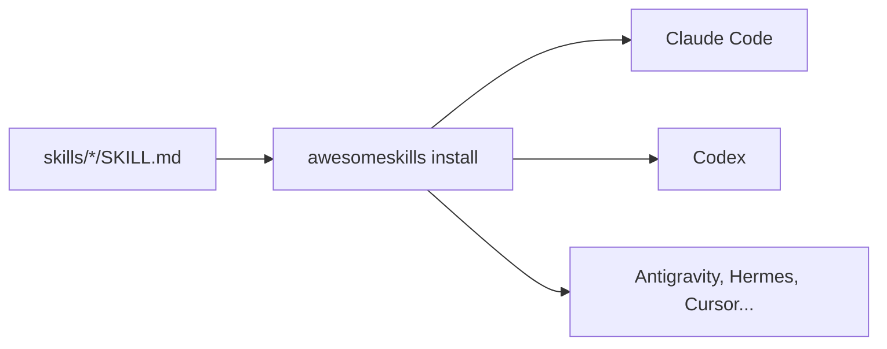

# awesome-skills

[](https://github.com/pedroiff0/awesome-skills/actions/workflows/ci.yml) [](LICENSE) [](https://github.com/pedroiff0/awesome-skills/stargazers) [](#status-e-próximos-passos)

Catálogo de skills procedurais (`SKILL.md`), servidores MCP e plugins para agentes de IA, com instalador que equipa Antigravity, Hermes Agent, Claude Code, Codex, Cursor, Windsurf, Roo/Cline e OpenCode a partir de um único formato.

Este projeto faz parte do [portfólio](https://portfolio.phrandrade.com/#awesome-skills) de Pedro Rocha.

## Sumário

- [Por que existe](#por-que-existe)
- [Funcionalidades](#funcionalidades)
- [Tecnologias](#tecnologias)
- [Instalação](#instalação)
- [Como usar](#como-usar)
- [Personalização](#personalização)
- [Como funciona](#como-funciona)
- [Trabalhando no projeto](#trabalhando-no-projeto)
- [Status e próximos passos](#status-e-próximos-passos)
- [Como contribuir](#como-contribuir)
- [Código de conduta](#código-de-conduta)
- [Segurança](#segurança)
- [Suporte](#suporte)
- [Estrelas e atividade](#estrelas-e-atividade)
- [Autor](#autor)
- [Contribuidores](#contribuidores)
- [Licença](#licença)

## Por que existe

Cada agente guarda skills num diretório e num formato próprios, e manter as mesmas instruções em cinco ferramentas vira cópia manual. Aqui a skill é escrita uma vez, em `SKILL.md`, e o instalador a distribui para os diretórios de cada agente.

## Funcionalidades

- Catálogo com mais de 120 skills organizadas por categoria (`skills/<categoria>/<skill>/SKILL.md`), com autoria e créditos de cada uma.
- Plugins (`plugins/`) com hooks de ciclo de vida e servidores MCP (`mcp/`) para banco de dados, sistema de arquivos e contexto.
- Instalador interativo (TUI) e CLI Python `awesomeskills`.
- Detecção do sistema operacional e dos agentes instalados, com links simbólicos ou cópia como alternativa.
- Referências curadas: repositórios open source (`references/open-source-repos.md`) e modelos locais do Ollama (`references/ollama-models.md`).

## Tecnologias

   

## Instalação

### Pré-requisitos

- Linux (suporte principal), macOS ou Windows (WSL recomendado).
- Python 3.9 ou superior e pelo menos um agente compatível instalado.

### Passos

```bash
git clone https://github.com/pedroiff0/awesome-skills.git
cd awesome-skills
pip install .
```

Instalação direta, sem clonar:

```bash
curl -fsSL https://raw.githubusercontent.com/pedroiff0/awesome-skills/main/install.sh | bash
```

### Conferindo

```bash
awesomeskills --help
```

Saída esperada: lista dos subcomandos (`install`, `list`, entre outros).

## Como usar

### Uso básico

```bash
awesomeskills install
```

O instalador detecta os agentes presentes, mostra o catálogo e instala as skills marcadas.

### Exemplos

| Quero | Comando |
| :--- | :--- |
| Instalar com a TUI | `awesomeskills install` |
| Instalar tudo por script | `curl -fsSL https://raw.githubusercontent.com/pedroiff0/awesome-skills/main/install.sh \| bash` |
| Ver o catálogo | `ls skills/` |
| Adicionar uma skill | criar `skills/<categoria>/<nome>/SKILL.md` e abrir um pull request |

## Personalização

| Opção | Onde | Padrão | O que muda |
| :--- | :--- | :--- | :--- |
| Diretórios dos agentes | detectados pelo instalador | `~/.claude`, `~/.codex`, `~/.gemini`, `~/.hermes`, `~/.cursor` | Destino das skills |
| Estratégia de instalação | instalador | link simbólico | Usa cópia no Windows sem permissão de link |

## Como funciona

Cada skill é uma pasta com um `SKILL.md` (frontmatter com nome e descrição, depois as instruções). O instalador lê o catálogo, resolve o diretório de cada agente conforme o sistema operacional e cria links ou cópias.



Índice completo das skills em [skills/](skills/).

## Trabalhando no projeto

```bash
pip install -e .
python -m pytest
```

1. Crie uma branch a partir de `main`: `git checkout -b feat/<assunto-curto>`.
2. Commits no padrão [Conventional Commits](https://www.conventionalcommits.org/pt-br/).
3. Rode os testes antes de abrir o pull request.
4. Registre a mudança na seção `Unreleased` de [CHANGELOG.md](CHANGELOG.md).

## Status e próximos passos

Estado atual: **ativo**. Linux é a plataforma verificada; macOS e Windows têm caminhos adaptados, sem teste contínuo.

- [x] Catálogo, instalador TUI e CLI Python
- [x] Plugins e servidores MCP de exemplo
- [ ] Testar o instalador em macOS e Windows
- [ ] Ampliar o catálogo de servidores MCP

## Como contribuir

Contribuições são bem-vindas. Antes de começar, leia o [guia de contribuição](CONTRIBUTING.md).

1. Abra uma issue descrevendo o problema ou a ideia.
2. Crie uma branch a partir de `main`: `git checkout -b feat/<assunto-curto>`.
3. Faça commits no padrão [Conventional Commits](https://www.conventionalcommits.org/pt-br/).
4. Abra o pull request e registre a mudança em [CHANGELOG.md](CHANGELOG.md).

## Código de conduta

Este projeto adota o [Código de Conduta](CODE_OF_CONDUCT.md). Ao participar, você concorda em segui-lo.

## Segurança

Não abra issue pública para vulnerabilidades. Siga o procedimento de [SECURITY.md](SECURITY.md) para reportar de forma confidencial.

## Suporte

Dúvidas e pedidos de ajuda: veja [SUPPORT.md](SUPPORT.md).

## Estrelas e atividade

[](https://star-history.com/#pedroiff0/awesome-skills&Date)

[](https://github.com/pedroiff0/awesome-skills/graphs/commit-activity) [](https://github.com/pedroiff0/awesome-skills/commits) [](https://github.com/pedroiff0/awesome-skills/issues) [](https://github.com/pedroiff0/awesome-skills/pulls)

<div align="center">

## Autor

<table>
  <tr>
    <td align="center"><a href="https://github.com/pedroiff0"><br /><sub><b>Pedro Henrique Rocha de Andrade</b></sub></a><br />Autor e mantenedor</td>
  </tr>
</table>

## Contribuidores

[](https://github.com/pedroiff0/awesome-skills/graphs/contributors)

</div>

## Licença

Distribuído sob a licença MIT. Texto completo do arquivo [LICENSE](LICENSE):

```txt
MIT License

Copyright (c) 2026 Pedro Henrique Ribeiro de Andrade

Permission is hereby granted, free of charge, to any person obtaining a copy
of this software and associated documentation files (the "Software"), to deal
in the Software without restriction, including without limitation the rights
to use, copy, modify, merge, publish, distribute, sublicense, and/or sell
copies of the Software, and to permit persons to whom the Software is
furnished to do so, subject to the following conditions:

The above copyright notice and this permission notice shall be included in all
copies or substantial portions of the Software.

THE SOFTWARE IS PROVIDED "AS IS", WITHOUT WARRANTY OF ANY KIND, EXPRESS OR
IMPLIED, INCLUDING BUT NOT LIMITED TO THE WARRANTIES OF MERCHANTABILITY,
FITNESS FOR A PARTICULAR PURPOSE AND NONINFRINGEMENT. IN NO EVENT SHALL THE
AUTHORS OR COPYRIGHT HOLDERS BE LIABLE FOR ANY CLAIM, DAMAGES OR OTHER
LIABILITY, WHETHER IN AN ACTION OF CONTRACT, TORT OR OTHERWISE, ARISING FROM,
OUT OF OR IN CONNECTION WITH THE SOFTWARE OR THE USE OR OTHER DEALINGS IN THE
SOFTWARE.
```

---

<div align="center">

 *"Keep looking up."*


<br>

<sub>© 2026 Pedro Rocha — Computer Engineering & Computational Astrophysics · IFF / PIBIC-CNPq, made with ☕, code and ☄️ by Pedro Henrique Rocha de Andrade</sub>

</div>

