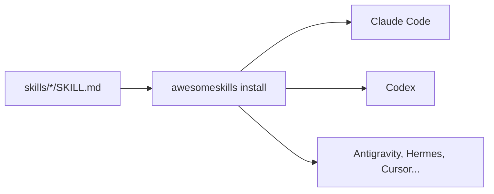

# awesome-skills

[](https://github.com/pedroiff0/awesome-skills/actions/workflows/ci.yml) [](LICENSE) [](https://github.com/pedroiff0/awesome-skills/stargazers) [](#status-e-próximos-passos)

Catálogo de skills procedurais (`SKILL.md`), servidores MCP e plugins para agentes de IA, com instalador que equipa Antigravity, Hermes Agent, Claude Code, Codex, Cursor, Windsurf, Roo/Cline e OpenCode a partir de um único formato.

Este projeto faz parte do [portfólio](https://portfolio.phrandrade.com/#awesome-skills) de Pedro Rocha.

## Sumário

- [Por que existe](#por-que-existe)
- [Funcionalidades](#funcionalidades)
- [Tecnologias](#tecnologias)
- [Instalação](#instalação)
- [Como usar](#como-usar)
- [Personalização](#personalização)
- [Como funciona](#como-funciona)
- [Trabalhando no projeto](#trabalhando-no-projeto)
- [Status e próximos passos](#status-e-próximos-passos)
- [Contribuindo e suporte](#contribuindo-e-suporte)
- [Autores](#autores)
- [Licença](#licença)

## Por que existe

Cada agente guarda skills num diretório e num formato próprios, e manter as mesmas instruções em cinco ferramentas vira cópia manual. Aqui a skill é escrita uma vez, em `SKILL.md`, e o instalador a distribui para os diretórios de cada agente.

## Funcionalidades

- Catálogo com mais de 120 skills organizadas por categoria (`skills/<categoria>/<skill>/SKILL.md`), com autoria e créditos de cada uma.
- Plugins (`plugins/`) com hooks de ciclo de vida e servidores MCP (`mcp/`) para banco de dados, sistema de arquivos e contexto.
- Instalador interativo (TUI) e CLI Python `awesomeskills`.
- Detecção do sistema operacional e dos agentes instalados, com links simbólicos ou cópia como alternativa.
- Referências curadas: repositórios open source (`references/open-source-repos.md`) e modelos locais do Ollama (`references/ollama-models.md`).

## Tecnologias

## Tecnologias

## Instalação

### Pré-requisitos

- Linux (suporte principal), macOS ou Windows (WSL recomendado).
- Python 3.9 ou superior e pelo menos um agente compatível instalado.

### Passos

```bash
git clone https://github.com/pedroiff0/awesome-skills.git
cd awesome-skills
pip install .
```

Instalação direta, sem clonar:

```bash
curl -fsSL https://raw.githubusercontent.com/pedroiff0/awesome-skills/main/install.sh | bash
```

### Conferindo

```bash
awesomeskills --help
```

Saída esperada: lista dos subcomandos (`install`, `list`, entre outros).

## Como usar

### Uso básico

```bash
awesomeskills install
```

O instalador detecta os agentes presentes, mostra o catálogo e instala as skills marcadas.

### Exemplos

| Quero | Comando |
| :--- | :--- |
| Instalar com a TUI | `awesomeskills install` |
| Instalar tudo por script | `curl -fsSL https://raw.githubusercontent.com/pedroiff0/awesome-skills/main/install.sh \| bash` |
| Ver o catálogo | `ls skills/` |
| Adicionar uma skill | criar `skills/<categoria>/<nome>/SKILL.md` e abrir um pull request |

## Personalização

| Opção | Onde | Padrão | O que muda |
| :--- | :--- | :--- | :--- |
| Diretórios dos agentes | detectados pelo instalador | `~/.claude`, `~/.codex`, `~/.gemini`, `~/.hermes`, `~/.cursor` | Destino das skills |
| Estratégia de instalação | instalador | link simbólico | Usa cópia no Windows sem permissão de link |

## Como funciona

Cada skill é uma pasta com um `SKILL.md` (frontmatter com nome e descrição, depois as instruções). O instalador lê o catálogo, resolve o diretório de cada agente conforme o sistema operacional e cria links ou cópias.



Índice completo das skills em [skills/](skills/).

## Trabalhando no projeto

```bash
pip install -e .
python -m pytest
```

1. Crie uma branch a partir de `main`: `git checkout -b feat/<assunto-curto>`.
2. Commits no padrão [Conventional Commits](https://www.conventionalcommits.org/pt-br/).
3. Rode os testes antes de abrir o pull request.
4. Registre a mudança na seção `Unreleased` de [CHANGELOG.md](CHANGELOG.md).

## Status e próximos passos

Estado atual: **ativo**. Linux é a plataforma verificada; macOS e Windows têm caminhos adaptados, sem teste contínuo.

- [x] Catálogo, instalador TUI e CLI Python
- [x] Plugins e servidores MCP de exemplo
- [ ] Testar o instalador em macOS e Windows
- [ ] Ampliar o catálogo de servidores MCP

## Contribuindo e suporte

Issues e pull requests são bem-vindos: veja [CONTRIBUTING.md](CONTRIBUTING.md), [CODE_OF_CONDUCT.md](CODE_OF_CONDUCT.md) e [SUPPORT.md](SUPPORT.md). Vulnerabilidades seguem [SECURITY.md](SECURITY.md).

## Autores

## Licença

MIT. Veja [LICENSE](LICENSE). Cada skill mantém o crédito do autor original.

Pedro Henrique Rocha de Andrade, 2026.
